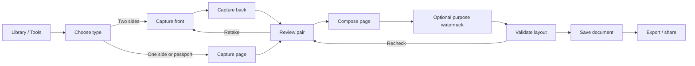

# LumaScan ID card studio — UI/UX, epic, and storyboard

Status: design-ready

Owner: Capture and document experience

Epic: ID-01

Last updated: 17 October 2026

## Deliverables

- [Eight-state ID card wireframe](./id-card-wireframe.svg)
- Interactive all-app prototype: [`design/index.html`](../../index.html), screen **05 — ID card studio**
- Product epic, user stories, acceptance criteria, storyboard, state model, content rules, and QA checklist in this document

The eight JPG files in this folder are behavioral references only. They contain real identity information. The LumaScan design does not reuse their names, numbers, faces, QR codes, document artwork, or visual styling. Every prototype identity is fictional and visibly marked `SAMPLE`.

### Reference-matched UI copy

The wireframe and interactive screen intentionally preserve the visible interface wording from the numbered references:

- `Shortcuts`, `Scan`, `ID Card`, `Scan Docs`, `Book`, `QR Code`, `To Text`
- `Process Files`, `Import Files`, `Collage Images`, `PDF Watermark`
- `A4 paper example`, `Make it now`, `Single Side`, `ID Card`, `Passport`
- `Front page`, `Back page`, `Import`
- `Tap the title above to rename; tap the picture to crop or rotate`
- `Add Watermark`, `Enter the content for the watermark`, `Cancel`, `OK`
- `Add`, `Collage`, `Share`, `Edit PDF`, `More`

The matching black camera chrome, white document surfaces, gray review background, alignment grid, green framing corners, green primary action, bottom toolbars, and two-column saved-page grid are also retained. Personal identity content from the references remains excluded.

## 1. Research synthesis

| Source | Useful behavior observed | LumaScan decision |
|---|---|---|
| `(1)` | ID Card appears as a direct scan shortcut. | Keep a first-class **ID copy** action in Library and Tools. |
| `(2)` | Front-and-back cards can be composed on one printable page. | Default to **Two sides** and preview both sides on A4/Letter. |
| `(3)` | A single-sided option is useful for badges and cards. | Offer **One side** without forcing an empty back slot. |
| `(4)` | Passport capture needs different proportions and guidance. | Offer **Passport page** with one required capture and portrait-page framing. |
| `(5)` | The active side must be explicit during camera capture. | Show **Capture front**, **Capture back**, and `1 of 2` / `2 of 2`; retain the confirmed side as a thumbnail. |
| `(6)` | Crop, rotate, filter, watermark, and confirm belong after capture. | Use a focused review screen before page composition; do not crowd the camera. |
| `(7)` | A purpose watermark is valuable but text entry needs context. | Use an optional toggle, safe copy suggestion, live page preview, and character limit. |
| `(8)` | Users expect sources to remain editable after composition. | Save one composite page while retaining reversible front/back source sides. |

## 2. Experience promise

**Both sides. One clear copy. Private by design.**

The user can create a clean, printable ID copy in under one minute, understand which side is being captured, correct mistakes without restarting, add a purpose watermark, and leave with one export-ready document page. LumaScan never implies that it verifies identity.

### UX principles

1. **One decision at a time.** Type, capture, review, layout, and save are separate steps.
2. **Side context never disappears.** The header and progress indicator state front/back progress.
3. **Privacy is visible.** “On-device,” “fictional sample,” and “does not verify identity” appear at the moments they matter.
4. **Correction is cheaper than restarting.** Retake either side, rotate, crop, swap, or return from layout.
5. **The final page is predictable.** Paper size, scale, margins, order, and watermark are previewed before save.
6. **No private reference material enters the product.** Design assets use abstract, fictional cards only.

## 3. Information architecture and flow



The all-app prototype keeps this as one route, `/id/:draftId`, with an internal state machine. Back moves one reversible step; **Start over** requires confirmation after a capture exists.

## 4. Screen specification

### ID-01 — Shortcut entry

- Library quick action: **ID copy**.
- Tools hub: **ID card studio** under Capture.
- Entry does not open a generic document camera first.
- Existing ID drafts open at Review or Layout, never silently reset.

### ID-02 — Choose document type

- Choices: **Two sides**, **One side**, **Passport page**.
- Two sides is the recommended default, visibly selected by border, fill, icon, and `aria-pressed`.
- Supporting copy explains the output, not a country or document brand.
- Primary action: **Make it now**.

### ID-03 — Capture front / page

- Camera guidance uses **Front page** and **Back page**, matching the references.
- A document-shaped guide replaces a full-page A4 guide.
- Live checks: all four edges, focus, glare, and usable scale.
- Auto-capture waits for stable geometry; manual shutter always remains available.
- Import uses a fictional sample in the prototype and a system picker in production.

### ID-04 — Capture back

- Appears only for Two sides.
- The confirmed front remains visible as a small thumbnail.
- **Retake front** does not discard the back if the back already exists.
- Side labels are text, not color-only.

### ID-05 — Review and correct

- Front and back cards show independent **Retake** actions.
- Shared tools: Rotate, Adjust crop, and Swap.
- A quality result is descriptive: `Sharp`, `Check glare`, `Too small`, or `Edge missing`.
- Low-quality captures can continue after a warning; only unusable input blocks composition.

### ID-06 — Compose one page

- Default: A4, 100% card scale, centered, front above back.
- Alternative: Letter; regional default follows app settings.
- Show print-safe margin and preserve aspect ratio.
- **Recheck captures** returns to Review without losing layout settings.

### ID-07 — Purpose watermark

- Off by default.
- When enabled, suggest `For [purpose] only` and optionally include the current date.
- Maximum 60 characters; preview updates while typing.
- Keep at least 4.5:1 contrast against the page while using transparency on the card.
- Placement avoids the portrait, identity number, QR/barcode, and machine-readable zone when those regions are known. If they are unknown, use a broad diagonal preview and make placement adjustable.

### ID-08 — Saved document

- Save creates one composite document page plus reversible side assets and edit recipes.
- Confirmation: **Saved on this device**.
- Actions: **Add**, **Collage**, **Share**, **Edit PDF**, and **More**.
- Export never removes the original side captures.

## 5. Epic ID-01 — Create a safe, printable ID copy

### Goal

Enable users to capture a small identity document, pair its sides correctly, correct the images, create a predictable one-page copy, reduce unintended reuse with a purpose watermark, and save or export without exposing identity data unnecessarily.

### Success measures

- At least 90% of completed Two sides attempts have correct front/back order without a later swap.
- Median time from type selection to Layout is under 60 seconds for a stable, well-lit card.
- Fewer than 5% of users abandon because they cannot correct a side.
- Zero raw ID images are uploaded unless a user explicitly invokes a separately consented cloud action.
- Every exported composite can be traced to its retained source sides and non-destructive recipes.

### US-ID-01.1 — Enter the right workflow

As a user, I want a direct ID-copy shortcut so that I do not configure a generic document scan.

Acceptance criteria:

- Library and Tools expose the same ID card studio route.
- The route announces its title and privacy mode to assistive technology.
- Opening a saved draft resumes the last valid step.

### US-ID-01.2 — Choose the document shape

As a user, I want to choose Two sides, One side, or Passport page so the guide and output fit my document.

Acceptance criteria:

- Exactly one type is selected.
- Changing type before capture is immediate.
- Changing type after capture explains which sides will be retained before modifying the draft.

### US-ID-01.3 — Capture a usable front

As a user, I want live framing and quality guidance so the front is readable.

Acceptance criteria:

- Four-corner framing, stability, focus, glare, and minimum-size checks have text feedback.
- Manual capture works when auto capture is off or unavailable.
- Camera denied offers Import and Open settings; it never shows a dead preview.

### US-ID-01.4 — Pair the back correctly

As a user, I want the app to ask for the back after the front so the sides remain paired.

Acceptance criteria:

- Two sides requires both captures before composition.
- The accepted front remains visible while capturing the back.
- Retaking one side does not discard the other.

### US-ID-01.5 — Correct the captures

As a user, I want to crop, rotate, retake, and swap so I can fix mistakes without restarting.

Acceptance criteria:

- Each side is independently editable.
- Crop has four touch targets and keyboard/screen-reader alternatives to dragging.
- Swap changes logical side assignment and preview order, not source image bytes.
- Undo is offered after an automatic correction.

### US-ID-01.6 — Build a predictable printable copy

As a user, I want to see the paper layout before saving so I know what will print.

Acceptance criteria:

- A4 and Letter previews show safe margins, order, and card scale.
- Aspect ratio is preserved and low-resolution input is not silently upscaled.
- One side and Passport omit the unused second slot.

### US-ID-01.7 — Limit unintended reuse

As a user, I want an optional purpose watermark so the copy is less useful outside its intended purpose.

Acceptance criteria:

- Watermark is explicitly opt-in and editable.
- Text is limited to 60 characters and previewed live.
- The final rendered watermark matches the preview within layout tolerance.
- An empty enabled watermark shows an actionable error and cannot be saved silently.

### US-ID-01.8 — Save, edit, and export privately

As a user, I want my composite and source sides saved locally so I can export now or revise later.

Acceptance criteria:

- Saving is transactional: the composite and both required source assets either commit together or the draft remains recoverable.
- Export is enabled only after the required sides and a valid layout exist.
- The UI states that copying does not verify identity.
- Delete removes the composite and source sides according to the app retention policy.

## 6. Storyboard

| Beat | Scene | User thought | LumaScan response | Exit condition |
|---|---|---|---|---|
| 1. Discover | Library quick actions | “I need one clean copy of my ID.” | Offers **ID copy** beside Scan and Import. | User taps ID copy. |
| 2. Decide | Type selection | “It has two sides.” | Recommends Two sides; explains one-page output and local processing. | A type is selected. |
| 3. Capture front | Camera guide | “Is the whole card readable?” | Shows a card-shaped frame, four-corner, focus, and glare status. | Front passes checks or user overrides. |
| 4. Capture back | Camera guide with front thumbnail | “Did it keep the front?” | Shows `2 of 2`, retains the accepted front, and offers Retake front. | Back is captured. |
| 5. Correct | Review pair | “The back is sideways.” | Rotate, crop, retake, swap, and quality guidance are available in place. | Required sides are usable. |
| 6. Compose | Paper preview | “Will this fit on one page?” | Shows A4/Letter safe area, order, scale, and margins. | Layout validates. |
| 7. Protect | Watermark option | “This copy is only for one purpose.” | Offers a purpose-specific watermark with immediate preview. | Watermark is off or valid. |
| 8. Finish | Saved document | “I may need to edit or share it.” | Saves locally, retains sources, and offers Export PDF, Share, and Edit. | Transaction completes. |

## 7. State and error model

| State | Message | Primary recovery |
|---|---|---|
| Camera permission denied | “Camera access is off. Import a photo or allow camera access.” | Import / Open settings |
| No document detected | “Fit all four corners inside the frame.” | Reposition / manual shutter |
| Glare | “Tilt the card slightly to reduce glare.” | Live retry |
| Blur or movement | “Hold steady for a sharper copy.” | Live retry / override |
| Card too small | “Move closer until the card fills the guide.” | Reposition |
| Missing back | “Capture the back to build a two-sided copy.” | Capture back |
| Invalid crop | “Corners cannot cross. Reset to detected edges?” | Reset / manual nudge |
| Empty watermark | “Add a purpose or turn the watermark off.” | Focus text field / disable |
| Low storage | “Your captures are safe in this draft. Free space before saving.” | Manage storage / retry |
| Save interrupted | “We kept your draft. Finish saving when you are ready.” | Resume save |

## 8. Accessibility and responsive behavior

- Minimum control target: 48 × 48 logical pixels.
- Reading order follows the visual task order: header, progress, content, primary action.
- `aria-current="step"` identifies progress; completed steps are announced as complete.
- Selection, error, quality, and completion never rely on color alone.
- Crop supports focusable corners, arrow-key/nudge controls, Reset, and spoken position labels.
- At 200% text, cards stack vertically and the primary action remains reachable above the safe area.
- Landscape prioritizes the camera guide; actions remain in a side rail.
- Reduced-motion mode removes shutter pulse, progress interpolation, and page-transition movement.
- All sample card labels pass contrast tests and remain visibly marked `SAMPLE`.

## 9. Privacy and security requirements

- Process edge detection, quality scoring, crop, composition, and watermark locally by default.
- Do not perform identity OCR, face matching, authenticity checks, or background upload in this workflow.
- Exclude image pixels, OCR values, and filenames from analytics, logs, crash reports, and support diagnostics.
- Store source sides under the same document access controls as the composite.
- Blur previews in the app switcher where supported; respect app lock if enabled.
- Cloud backup and external sharing require separate, explicit user actions and disclose the destination.
- Use generic thumbnails in notifications; never expose a portrait or document number.

## 10. Handoff model

Suggested draft fields:

```text
IdCopyDraft
  id
  type: twoSided | singleSided | passport
  step: type | capture | review | layout
  frontAssetId?
  backAssetId?
  frontRecipe?
  backRecipe?
  sideOrder
  paperSize
  scalePercent
  spacing
  watermark: { enabled, text, opacity, rotation, position }
  qualityWarnings[]
  createdAt / updatedAt
```

Events may record `id_flow_started`, `id_type_selected`, `id_side_captured`, `id_quality_warning_shown`, `id_layout_opened`, and `id_copy_saved` with coarse state only. They must not contain document pixels, extracted text, document numbers, names, or watermark text.

## 11. Definition of done

- [ ] All eight storyboard states are implemented or explicitly marked as prototype-only.
- [ ] Two sides, One side, and Passport each complete without unreachable controls.
- [ ] Front/back order survives app backgrounding, rotation, and process recreation.
- [ ] Retake, crop, rotate, swap, and Recheck preserve the other valid work.
- [ ] A4 and Letter output match the preview and printer-safe bounds.
- [ ] Watermark validation, rendering, and accessibility are covered by tests.
- [ ] Permission, glare, blur, missing side, invalid crop, low storage, and interrupted save recover safely.
- [ ] Screen-reader, 200% text, keyboard/switch access, contrast, and reduced motion pass review.
- [ ] No source reference PII or production ID is committed to design assets, fixtures, logs, or snapshots.
- [ ] The standalone wireframe is linked from the main all-app prototype and screen 05 runs end to end.
