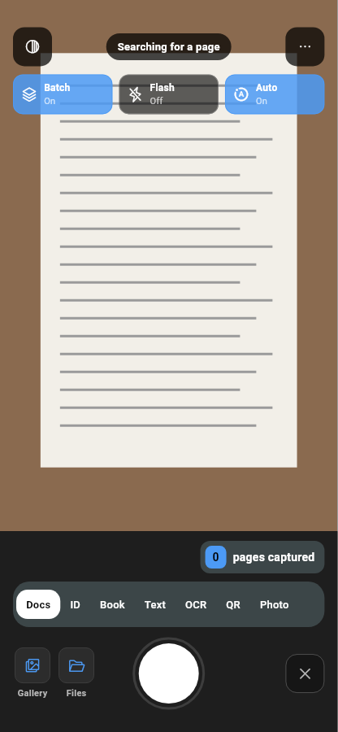
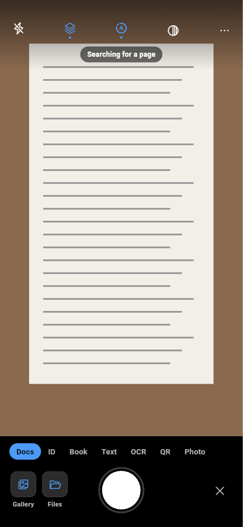

# Camera preview layout (v1.38.0)

Varun asked (2026-11-03) for a cleaner camera screen with smaller controls and
more room for the page preview, after looking at how a leading scanner app
lays out its camera. We took general layout lessons only. Icons, colours and
the exact arrangement stay LumaScan's own (LumaIcons, LumaColors accent).

## Lessons taken

- The preview should fill most of the screen. The reference app gives it about
  80% of the height; ours gave it about 73% before this change.
- Top controls are one slim row of bare icons with no boxes or labels. State
  is shown by the icon itself.
- The mode picker is plain text on black, with only the picked mode filled.
- One short hint sits over the preview; nothing else covers the page.
- The bottom row is only: import or thumbnail, shutter, close.

## What changed in LumaScan

| Area | Before | After |
| --- | --- | --- |
| Top controls | Filter and More buttons in dark boxes, plus a second row of three big Batch / Flash / Auto cards with On/Off text | One row of five bare icons: Flash, Batch, Auto, Filter, More. An "on" icon turns accent blue with a small dot under it |
| Behind the top row | Nothing (controls boxed) | A soft black fade, so white icons read on a bright page |
| Hint chip | 13 pt | 12 pt, lighter background |
| Page count | A "0 pages captured" pill above the modes | Removed. The count badge on the thumbnail already shows it |
| Mode strip | Grey rounded box, white pill for the picked mode | No box, grey labels, accent pill for the picked mode |
| Shutter | 86 dp ring, 74 dp button | 76 dp ring, 66 dp button |
| Close (discard) | Outlined dark box | Bare icon |
| Bottom panel | Grey surface, 12 dp padding | Black, tighter padding |

Preview height on a 412 x 851 dp phone went from about 653 dp to about 745 dp.

Tap targets stay at least 48 dp (`minTapTarget`), and screen reader labels are
unchanged ("Batch On", "Flash Off", "Auto On", "Camera settings").

| Before | After |
| --- | --- |
|  |  |

The screenshots are widget renders with a drawn test page, not device photos.
