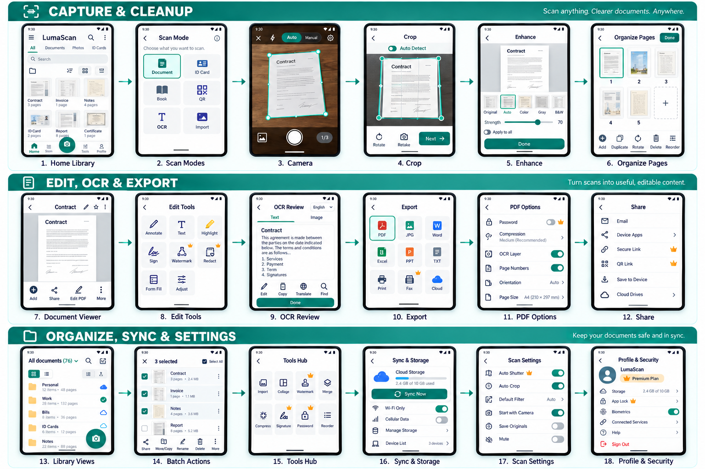
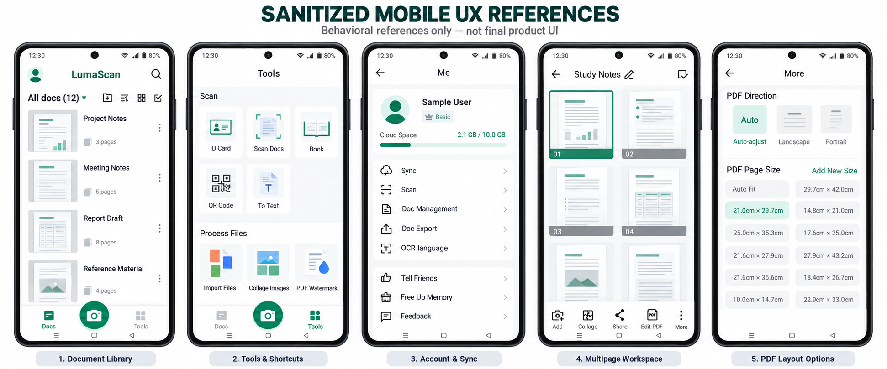

# Document Scanner UX Flow — Android

This is an original Android UX specification informed by the public feature set of CamScanner and the supplied OKEN Scanner reference screenshots. It is not a pixel-for-pixel copy of either product and does not reuse their branding, icons or proprietary artwork in the implementation.

Private source screenshots were used as **behavioral references**. They show useful information architecture, controls and states; they are not visual templates. The raw captures contain personal information and are intentionally omitted from the public repository. The storyboard below is the sanitized, original design derived from that research.

### Sanitized mobile references

The following sheet preserves representative information architecture from the private research captures while replacing personal data, real document content and third-party branding. It is included for design comparison only and is not the final product UI.

## Product expectation

The product should feel like a fast, local-first scanner rather than a general file browser. A user must be able to open the app, capture a multipage document, correct it and create a PDF without signing in. Account, sync and premium features enhance that path but must not block it.

Release expectations:

- **Release 1 — required:** document library, list/grid/expanded views, folders and tags, search and sort, batch selection, document/ID/book/QR/OCR capture entry points, gallery/PDF import, crop and filters, multipage organization, PDF/JPG export, signatures, watermark, PDF password, local storage settings and recoverable errors.
- **Release 1.1 — expected:** cloud sync, data-usage controls, compression, merge, page numbering/orientation/size, storage cleanup, configurable scan defaults and structured feedback.
- **Release 2 — optional/connected:** Office conversion, secure share links, collaboration, third-party cloud destinations, wireless printing, fax and layout-preserving translation.

Success measures:

- First usable scan can be created in three primary taps after permission is granted.
- A 20-page document can be renamed, tagged, reordered and exported without leaving the document workspace.
- Every long-running operation reports progress and preserves the source if it fails.
- Local capture, edit and PDF/JPG export work offline.
- Premium status is explained before a gated action begins.

## Product structure

Primary navigation: **Home**, **Folders**, **Scan**, **Recent**, **Profile**.

The centered Scan action is always available. Creation tools open as a bottom sheet so the user can start a task in one tap.

## Screen-by-screen flow

### A. First run and account

1. **Splash** — logo, loading indicator, offline-safe startup.
2. **Onboarding 1: Scan** — camera scanning, automatic edge detection, multipage capture.
3. **Onboarding 2: Improve** — smart crop, perspective correction, enhancement filters.
4. **Onboarding 3: Use** — OCR, annotate, sign, export and share.
5. **Sign in / continue as guest** — email, Google, phone, guest mode, terms and privacy links.
6. **Permission primer** — separate explanations for camera, photos/files, and notifications; permissions are requested only after the related action.
7. **Premium offer** — dismissible comparison of Free and Premium; restore purchase and subscription terms.

### B. Home and organization

Reference coverage: library list, folder creation, sorting, grid, expanded preview, batch selection, tags and empty categories.

8. **Document library** — search, profile, storage/sync status, category selector with item count, create folder, list/grid/expanded-preview switch, sort, multi-select and persistent Scan CTA. Each document shows name, modified time, page count, representative thumbnail and sync state.
9. **Global search** — recent searches; search title, tags and OCR text; filters for file type, folder, date and owner.
10. **Folders** — create with suggested date-based name, rename, color, pin, lock, reorder and delete folders. Cancel must never create a partial folder.
11. **Folder detail** — breadcrumbs, item count, share folder, move items, sort and batch actions.
12. **Tags / recent / starred / shared** — tag manager with built-in and user-created tags, counts and alphabetical sections; segmented document views with offline and sync state badges.
13. **Trash** — restore, permanently delete and retention notice.

### C. Start scan

Reference coverage: the Tools hub exposes capture modes and file-processing shortcuts in one discoverable catalog.

14. **Create sheet** — Camera, Import images/files, Import PDF, New folder, OCR text, QR scan and recently used action.
15. **Scan-mode chooser / Tools hub** — Document, ID card, Book, Question/worksheet, Whiteboard, QR/barcode and Batch. A secondary processing group exposes collage, watermark, merge, compression, signature, password and page reorder without forcing users to open an existing document first.
16. **Camera permission state** — explanation, Allow action, open Settings fallback.
17. **Live camera** — edge polygon, stability hint, flash, resolution, timer, auto/manual toggle, gallery, capture, page counter, mode carousel and close.
18. **Capture confirmation** — thumbnail tray, retake, keep, add page and finish.

### D. Specialized capture modes

19. **ID front** — card outline, glare warning, auto capture.
20. **ID back** — same outline with front thumbnail and swap sides.
21. **ID layout** — front/back arrangement, paper size, background, watermark and export.
22. **Book scan** — two-page detection, center-spine guide, finger-removal hint and page split preview.
23. **Batch scan** — continuous capture, duplicate/blur warnings, page counter and pause/resume.
24. **QR/barcode result** — detected value, open/copy/share/save, safety warning for external links.
25. **Gallery import** — albums, multi-select, capture order, file limit and import progress.
26. **PDF import** — file picker, password prompt, page range, thumbnail selection and conversion progress.

### E. Scan cleanup

27. **Crop and perspective** — draggable corners and edge points, auto-detect, rotate, mirror, reset, magnifier, retake and apply-to-all.
28. **Enhance** — Original, Auto, Color, Lighten, Gray, B&W; strength slider; brightness, contrast, sharpness and denoise.
29. **Page review** — full-page preview, before/after hold gesture, back, save and next-page count.
30. **Multipage organizer** — grid/list, drag reorder, add, duplicate, rotate, delete, crop, filter and select all.
31. **Quality issue dialog** — blur, glare, clipped edge or low light; retake or keep anyway.

### F. Document workspace

Reference coverage: multipage document workspace, secondary actions and PDF layout controls.

32. **Document detail** — editable title, page count, tags, favorite, comments/activity, overflow menu and responsive page grid. Persistent actions are Add, Share, Edit PDF and More; page numbering remains visible while scrolling.
33. **Page tools drawer** — Annotate, OCR, Sign, Watermark, Redact, Form fill, Adjust, Replace, Batch edit, Set tag and manual page sorting.
34. **Annotate** — pen, highlighter, text box, shapes, note, color, thickness, eraser, undo/redo and flatten warning.
35. **Signature library** — create by draw/type/import, choose saved signature, rename and delete.
36. **Place signature** — resize, rotate, opacity, color, date stamp, duplicate and apply.
37. **Watermark** — text/image, font, color, opacity, angle, tiled/single position and page range.
38. **Redaction** — draw areas, find sensitive text, preview, irreversible export warning.
39. **Form fill** — text fields, check marks, dates, initials and field navigation.
40. **Page adjustment** — crop, rotate, perspective, filter, brightness, contrast and background cleanup.

### G. OCR and conversion

41. **OCR language selection** — automatic or manual language, page range and recognition-quality options.
42. **OCR processing** — page progress, continue in background, cancel and retry.
43. **OCR review** — Text/Image tabs, editable recognized text, confidence highlights, find/replace and copy.
44. **Translate** — source/target language, side-by-side text, preserve-layout option and export.
45. **Convert** — PDF/JPG to Word, Excel, PowerPoint or TXT; selected pages, output name and destination.
46. **Conversion result** — preview, open, share, save copy and report formatting problem.

### H. Export, share and delivery

47. **Export sheet** — PDF, JPG, Word, Excel, PowerPoint and TXT; premium badges where applicable.
48. **PDF settings** — page size (Auto Fit, A3, A4, A5, B4, B5, Letter, Legal and custom), auto/portrait/landscape orientation, margin, image quality, compression, OCR text layer, page numbers (none, lower-left, lower-center, lower-right), watermark and password.
49. **JPG settings** — page range, quality, resolution, individual images or ZIP.
50. **Share sheet** — device apps, email attachment, secure link, QR link and copy link.
51. **Secure link** — expiry, password, download permission, comment permission and revoke link.
52. **Cloud destination** — device, CamScanner-style sync space, Google Drive, Dropbox, OneDrive, Evernote and WebDAV when connected.
53. **Print** — printer, copies, page range, size, color and duplex where supported.
54. **Fax** — country/number, cover page, page selection, credit estimate, send and delivery status.
55. **Export progress/result** — background progress, cancel, retry, open file and share.

### I. Security, sync and account

Reference coverage: account/storage summary, settings, OCR language, document defaults, sync, referral, cleanup and support.

56. **Profile** — account identity, plan, used/available cloud storage, referral, cleanup, support, app information and sign out.
57. **Backup and sync** — manual Sync now, last-sync timestamp, cellular-data permission, Wi-Fi-only mode, conflict policy, device list and retry.
58. **Document security** — app lock, biometric unlock, PIN change, locked folders and screenshot protection where supported.
59. **Connected services** — connect/disconnect cloud drives, printer and WebDAV; permission scopes.
60. **Premium plans** — weekly/monthly/quarterly/annual options, trial terms, feature comparison, restore and manage subscription.
61. **Settings** — default naming template; page-detail and tag-bar visibility; storage destination; auto shutter; auto crop; crop-after-each-scan; default enhancement; mute mode; start with camera; auto-save to gallery; double-focus; PDF defaults; OCR languages; theme; notifications; cache and data controls.
62. **Help and feedback** — categorized help for crash/lag, capture/import, photo editing, OCR, sharing/export, rewards, interface and other issues; feedback text, up to nine screenshots, email confirmation, diagnostics opt-in, submit state and app version.

### J. Required system and failure states

63. **Empty library** — example document categories and Scan/Import actions.
64. **No search results** — clear filters and scan/import suggestion.
65. **Offline** — local editing remains available; sync/share-link/fax actions explain their limitation.
66. **Storage full** — storage breakdown, clear cache, manage exports and upgrade storage.
67. **Sync conflict** — compare local/cloud metadata; keep local, keep cloud or duplicate both.
68. **Protected PDF** — password field, show/hide, retry and cancel.
69. **Processing failure** — retained source, reason, retry and export original.
70. **Permission denied** — open system Settings and offer an alternate import path.
71. **Delete confirmation** — move to Trash by default; permanent deletion requires explicit confirmation.

## Primary happy path

`Home → Scan mode → Camera → Crop → Enhance → Add/reorder pages → Document detail → OCR/annotate/sign → Export settings → Share/save → Success`

## Important branch flows

- **ID:** Scan mode → ID front → ID back → ID layout → Export.
- **Import:** Create sheet → Gallery/PDF → Select → Crop/enhance → Organize → Save.
- **OCR:** Document detail → OCR language → Processing → Review/correct → Copy/translate/convert.
- **Secure share:** Document detail → Export → Secure link → Access controls → Share → Link activity/revoke.
- **Locked content:** Folder/document overflow → Lock → Set/confirm PIN → Biometric option → Locked-state viewer.

## Feature expectations and acceptance criteria

### Library and organization

- The selected library layout and sort order persist across launches.
- Sort supports modified newest/oldest, created newest/oldest and name A–Z/Z–A.
- Long-press enters batch mode; Select all, Share, Move/Copy, Rename, Delete and More update their enabled state from the selection.
- Expanded preview shows several page thumbnails and a `+N` remainder count without loading every full-resolution page.
- Built-in tags include common document types; users can add, rename and remove custom tags. Removing a tag does not delete its documents.
- Empty categories retain the standard library chrome and offer a direct Scan new docs action.

### Tools and file processing

- Tools are grouped as Scan, Process files and PDF tools; availability and premium status are visible before selection.
- Import accepts supported images, PDFs and office files through Android's system picker and reports unsupported/encrypted files clearly.
- Merge and reorder present page thumbnails, drag handles and a final preview.
- Compression shows original size, estimated result and quality trade-off before writing a new file.
- Collage, watermark, signature and password operations create a new version by default so the source remains recoverable.

### Capture and enhancement

- Auto shutter waits for a stable document outline and gives visible feedback before capture.
- Auto crop and crop-after-each-scan are independent preferences.
- The user can choose a default enhancement mode and override it per page or for the entire batch.
- Mute mode follows platform restrictions; when shutter sound cannot legally be disabled, explain why.
- Start with camera bypasses Home only after onboarding and permissions are complete.
- Auto-save to gallery is opt-in and states whether originals, processed pages or both are saved.
- Double-focus is presented as a quality/speed trade-off.

### Document and PDF editing

- Multipage documents support add, duplicate, delete, rotate, recrop, filter, manual reorder and batch edit.
- Page direction can be Auto, Portrait or Landscape. Page-size choices use both standard names and dimensions instead of dimensions alone.
- Page numbering supports none and lower-left/center/right placement, with preview and start-number controls.
- PDF password creation requires confirmation and warns that forgotten passwords cannot be recovered.
- Premium-only features use a consistent badge and remain previewable where possible.

### Account, storage and sync

- Profile clearly separates device storage from cloud quota.
- Sync shows last-success time and per-document pending/success/error state.
- Cellular sync is off by default for large originals; enabling it explains potential data use.
- Storage destination changes apply to new files unless the user explicitly chooses to migrate existing content.
- Free Up Memory first scans and categorizes removable cache, previews the reclaimable amount, then asks for confirmation before deletion.

### OCR and support

- OCR language selection is searchable, supports multiple languages where the engine permits it and identifies downloaded/offline language packs.
- OCR retains the source image and highlights low-confidence text for correction.
- Support uses structured issue categories, accepts up to nine images and never attaches documents or diagnostics without explicit consent.
- Referral or promotional dialogs are dismissible, accessible and never interrupt capture, editing or export.

## Research traceability

| Private reference | Observed pattern | Applied to |
|---|---|---|
| 01–06 | Library layouts, create folder, sorting and selection | Screens 8–13 |
| 07–08 | Scan shortcuts, process-file tools and PDF utilities | Screens 14–15, 45, 47–49 |
| 09–12 | Tags and category empty states | Screens 12 and 63 |
| 13–18 | Profile, OCR, document, sync and scan preferences | Screens 41 and 56–61 |
| 19–22 | Referral, storage cleanup and support | Screens 56, 62 and 66 |
| 23–25 | Multipage workspace and PDF options | Screens 30–33 and 48 |

“Observed” means visible in the supplied private screenshots. Those raw screenshots are deliberately excluded from source control because they include personal information. Features elsewhere in this specification are product requirements or proposed improvements and must not be presented as verified behavior of the reference app.

## Interaction and accessibility rules

- Use Material 3 patterns and Android back behavior.
- Keep primary actions at the lower-right or bottom edge and reachable with one hand.
- Use 48 dp minimum targets, scalable text, TalkBack labels and visible focus order.
- Never communicate scan quality, premium status or errors by color alone.
- Preserve originals until the user explicitly deletes them; destructive edits need undo or confirmation.
- Show premium gates before processing starts, not after the user waits.
- Keep camera, crop and export usable without an account; require sign-in only for sync and collaborative link features.
